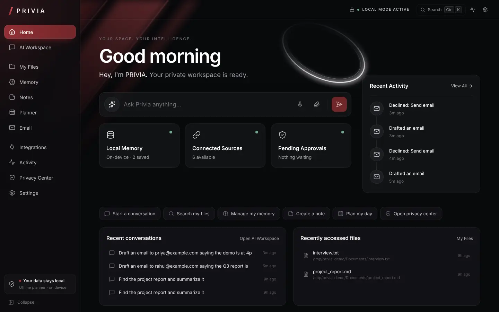
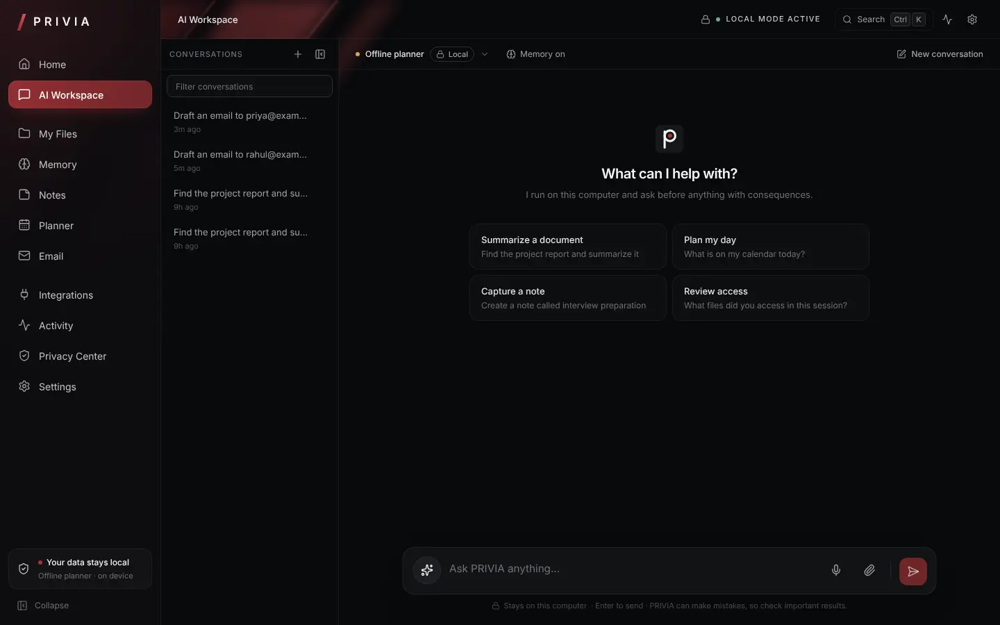
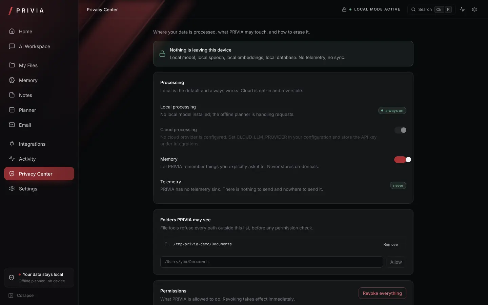

# PRIVIA

**Your space. Your intelligence.**

PRIVIA is a personal AI assistant that runs on your own computer. It finds and
summarizes your documents, keeps notes and memories, plans your day, drafts
email and explains everything it did. It reads only the folders you allow and
asks before it does anything with consequences.

Local by default: a local model through [Ollama](https://ollama.com), a local
database, no account, no sync, no telemetry. Cloud models are optional and off
until you turn them on.



| | |
|---|---|
|  |  |

- **Download:** [GitHub Releases](https://github.com/MohitKB22/Privia/releases/latest) · **Website:** [mohitkb22.github.io/Privia](https://mohitkb22.github.io/Privia/)
- **Platforms:** macOS 11+ (Apple Silicon and Intel), Windows 10/11 (64-bit), Linux x86-64 (`.deb`, `.rpm`, AppImage)
- **License:** Apache-2.0

---

## The one idea

> **The language model proposes. A deterministic runtime disposes.**

The model never touches your filesystem, your mailbox or a shell. It emits a
structured tool call. A separate runtime validates the arguments against a
schema, checks them against the permissions you granted, shows you a preview if
the action has consequences, runs it with a timeout and records what happened.
There is no code path from model output to a side effect that skips that
runtime.

---

## Install

1. **Download** the installer for your system from
   [Releases](https://github.com/MohitKB22/Privia/releases/latest).
2. **Verify it (optional, recommended).** Each release has `SHA256SUMS.txt`:
   ```bash
   shasum -a 256 PRIVIA-*.dmg            # macOS
   sha256sum PRIVIA-*                    # Linux
   Get-FileHash PRIVIA-*.exe             # Windows PowerShell
   ```
   The hash must match the line for that file.
3. **Install.**
   - **macOS:** open the `.dmg` and drag PRIVIA to Applications. The current
     builds are not notarized by Apple, so the first launch may be blocked: open
     **System Settings → Privacy & Security** and choose **Open Anyway**.
   - **Windows:** run `PRIVIA-<version>-windows-x64-setup.exe` (or the `.msi`).
     The installer is not signed with a Microsoft certificate yet, so SmartScreen
     may warn you: choose **More info → Run anyway**.
   - **Linux:** `sudo apt install ./PRIVIA-<version>-linux-x64.deb`, or
     `sudo dnf install ./PRIVIA-<version>-linux-x64.rpm`, or
     `chmod +x PRIVIA-*.AppImage && ./PRIVIA-*.AppImage`.

You do not need Python, Node or a terminal. The installer contains the app and
its local backend; the app starts and stops the backend itself.

### First run

PRIVIA opens a short setup that:

1. checks that the local backend and database are ready,
2. looks for a local model and helps you install one if there is none,
3. shows where requests run (local by default; cloud only if you configured it),
4. explains how permissions work, and
5. lets you allow folders and capabilities one at a time. Nothing is allowed
   until you say so.

You can re-run it from **Settings → Troubleshooting → Run setup again**.

### Add a local model (Ollama)

1. Install Ollama from [ollama.com/download](https://ollama.com/download) and open it.
2. Download a model:
   ```bash
   ollama pull llama3.2:3b     # about 2 GB, fine with 8 GB of RAM
   ollama pull llama3.1:8b     # about 5 GB, better answers, 16 GB recommended
   ```
3. In PRIVIA, open **Settings → AI model**, press **Check again** and choose the
   model. You can also switch models from the model menu in the AI Workspace.

Without a model, PRIVIA still works with its offline planner: files, notes,
calendar, memory and email drafts all function, and replies are phrased from
templates instead of generated.

**Free hosting is not free compute.** PRIVIA itself is free. A local model runs
on your own processor and memory, so speed depends on your computer. If you
choose a cloud provider, you pay that provider with your own API key.

### Upgrade

Download the new version and install it over the old one. Your data lives
outside the app (see below) and is kept. Database migrations run automatically
on start. PRIVIA never updates itself or checks for updates in the background.

### Uninstall

- **macOS:** delete PRIVIA from Applications.
- **Windows:** Settings → Apps → PRIVIA → Uninstall.
- **Linux:** `sudo apt remove privia` / `sudo dnf remove privia`, or delete the AppImage.

To remove your data as well, use **Privacy Center → Delete data** first, or
delete the `.privia` folder in your home directory (database, logs, local
mailbox, calendar files and encrypted credentials).

---

## What it does

| Section | What you can do | What it will not do |
|---|---|---|
| **Home** | ask anything, see memory, sources and pending approvals, recent activity | invent numbers: every card is live data |
| **AI Workspace** | streaming replies with Markdown and code, stop, copy, regenerate, attach a file, hold-to-talk, choose the model, conversation history | hide where a reply was processed |
| **My Files** | browse, search, preview, summarize and create files in allowed folders | look outside allowed folders, read `.ssh`/`.env`/keys, delete without approval |
| **Memory** | add, search, edit, pin, forget; see where each memory came from | store passwords, API keys or card numbers |
| **Notes** | write, tag, pin, search (full text), summarize locally | leave your computer |
| **Planner** | day and week views, search, add and cancel events | change your calendar without showing you the details first |
| **Email** | drafts, local or IMAP mailbox, read, reply as a draft | send anything without your explicit approval, every time |
| **Integrations** | see each connection, its permissions, last use; disconnect; store credentials | show you a stored credential again |
| **Activity** | every tool call, approval, refusal and failure, live | be edited by the assistant |
| **Privacy Center** | local/cloud status, folders, permissions, export, delete | send telemetry (there is none) |

---

## Privacy

**Local by default.** The model, speech, embeddings and database run on your
computer. PRIVIA makes an outbound connection on its own only when you ask it to
read a web page.

**Cloud is opt-in twice.** It needs a configured provider *and* the
`cloud:inference` permission. When it is on, the top bar says so, and every reply
is labelled with where it was processed.

**No telemetry, no update checks.** There is no analytics code in the project.

**You can see and erase everything.** Activity records every action before the
answer is shown. The Privacy Center exports everything PRIVIA stores about you as
JSON, and deletes conversations, memories and the audit log independently.

More in [PRIVACY.md](PRIVACY.md).

## Security

- **Approval is exact.** A confirmation id is a SHA-256 hash of the
  conversation, the tool and the exact arguments. Change the recipient of an
  approved email and it is a different action that needs a new approval. Approvals
  are single use and expire.
- **Paths** are resolved before they are checked, so `../` and symlinks cannot
  escape an allowed folder; credential files are blocked even inside one.
- **Commands** run from an allow-list as an argument vector with `shell=False`.
- **URLs** are resolved and checked before every connection and redirect;
  private, loopback and metadata addresses are blocked.
- **Untrusted content** (web pages, emails, files, command output) is wrapped as
  data and screened for injected instructions before a model sees it.
- **The local API** listens on loopback only, requires a per-launch token that
  the desktop app generates, and refuses foreign `Host` headers and foreign
  browser origins, which blocks DNS-rebinding and cross-site requests from web
  pages open in your browser.
- **The desktop window** has no shell, filesystem or dialog permissions; every
  privileged action is a small Rust command that validates its input.
- **Credentials** live in the OS keychain or an AES-GCM encrypted file, never in
  the database, logs or exports.

Threat model and reporting: [SECURITY.md](SECURITY.md).

---

## Architecture

```
PRIVIA.app / PRIVIA.exe  (Tauri 2 shell, Rust)
 │  picks a free loopback port and a per-launch token,
 │  starts the bundled backend, stops it on exit
 ├── Web view: React 18 + TypeScript + Tailwind ──┐
 │                                                │ HTTP on 127.0.0.1, Bearer token
 └── privia-backend (frozen Python sidecar) ◄─────┘
       FastAPI ── Host/Origin guard · auth · size limit · rate limit
       Agent ──── classify → plan → policy → execute → verify → respond
       Tool runtime ── schema → permission → confirmation → timeout → audit
       Providers ─ files · notes · calendar · email · web reader · terminal
       Storage ── SQLite + migrations (~/.privia)
       Models ─── Ollama (local) · OpenAI / Anthropic (optional) · offline planner
```

```
privia/
├── apps/api/              FastAPI application
├── apps/desktop/          React client and Tauri shell (src-tauri/)
├── packages/              shared-types · security · storage · tool-runtime ·
│                          agent-core · memory · observability
├── services/              llm · embeddings · speech · integrations
├── packaging/             backend sidecar build, smoke test, artifact collection
├── site/                  product website (GitHub Pages)
├── tests/                 unit · integration · security · e2e
├── docs/                  architecture, API, audit, releasing, diagrams
└── scripts/               setup, icons, version, packaging
```

Details: [docs/ARCHITECTURE.md](docs/ARCHITECTURE.md) · API: [docs/API.md](docs/API.md)

**Stack:** Python 3.10–3.13, FastAPI, Pydantic 2, SQLAlchemy/SQLite, httpx;
React 18, TypeScript, Vite, Tailwind, Lucide, react-markdown; Tauri 2 (Rust);
PyInstaller for the backend sidecar; GitHub Actions for CI and releases.

---

## Development

Requirements: Python 3.10+, Node 20+, and Rust (only to build the desktop shell).

```bash
git clone https://github.com/MohitKB22/Privia.git
cd Privia
make install-dev      # virtualenv, Python and UI dependencies
make migrate
make dev              # backend on 127.0.0.1:8756, UI on 127.0.0.1:5173
```

Open <http://127.0.0.1:5173> for the UI in a browser, or run the native shell
against the dev backend with `make dev-desktop`.

| Command | What it does |
|---|---|
| `make test` | 508 Python tests (unit, integration, security, end to end) |
| `make test-security` | the adversarial suite on its own |
| `make test-ui` | 31 frontend tests |
| `make lint typecheck` | ruff, black, mypy, ESLint, tsc |
| `make check` | everything CI runs |
| `make doctor` | diagnose an installation |
| `make build-desktop` | sidecar, smoke test, icons and installers for this platform into `release/` |
| `make version` | check the version is the same in every file |

The test suite runs offline and needs no model.

### Configuration

Every setting is optional; copy `.env.example` to `.env` for development. The
desktop app needs none of this.

| Variable | Default | Notes |
|---|---|---|
| `LOCAL_LLM_MODEL` | `llama3.1:8b` | Default Ollama model; the app can switch at runtime. |
| `OLLAMA_BASE_URL` | `http://127.0.0.1:11434` | |
| `CLOUD_PROCESSING_ENABLED` | `false` | Also needs a provider, a key, and the permission. |
| `CLOUD_LLM_PROVIDER` | *(empty)* | `openai` or `anthropic`; store the key under Integrations. |
| `PRIVIA_HOST` | `127.0.0.1` | Binding elsewhere requires `PRIVIA_API_TOKEN`. |
| `EMAIL_PROVIDER` | `local` | `local` transmits nothing; `smtp` uses your own account. |

### Releasing

Versions, tags, the release workflow, signing and the website are covered in
[docs/RELEASING.md](docs/RELEASING.md). In short:

```bash
python scripts/version.py set 1.0.1 && git commit -am "Release 1.0.1"
git tag v1.0.1 && git push origin main v1.0.1
```

GitHub Actions builds every installer, smoke-tests the backend on each
platform, and drafts a release with checksums for you to publish.

---

## Troubleshooting

| Symptom | Fix |
|---|---|
| "PRIVIA could not start its assistant" | Press **Restart assistant**. The screen shows the backend's last log lines; **Settings → Troubleshooting → Copy diagnostics** gives a report without personal data. |
| Model shows "Offline planner" | Start Ollama and pull a model, then **Settings → AI model → Check again**. |
| Files are empty or "Outside your allowed folders" | Allow the folder in **My Files** or the **Privacy Center**, and grant `files:read`. |
| macOS says the app is damaged or cannot be opened | System Settings → Privacy & Security → **Open Anyway**, or `xattr -dr com.apple.quarantine /Applications/PRIVIA.app`. |

More in [docs/TROUBLESHOOTING.md](docs/TROUBLESHOOTING.md).

---

## Known limitations

- **Installers are not code-signed or notarized yet.** macOS and Windows warn on
  first launch. Signing needs an Apple Developer ID and a Windows certificate,
  both paid; the release workflow uses them automatically once added as secrets.
- **The Windows backend is not covered by blocking CI tests yet.** It is built
  and smoke-tested in every release, and its full test run is reported but does
  not block.
- **Intel Macs are built on GitHub's last Intel runner,** which GitHub plans to
  retire in 2027.
- **Without a local model, replies are templated.** Every tool works; wording is
  simpler and there is no open conversation.
- **Local embeddings are lexical** unless you install an Ollama embedding model.
- **Email defaults to a local mailbox;** nothing is sent until you configure SMTP.
- **Calendar is local iCalendar files;** there is no CalDAV or Google sync.
- **The web reader is a reader:** no JavaScript, forms or signed-in pages.
- **One person per installation;** there is no multi-user or remote mode.

---

## License

Apache-2.0. See [LICENSE](LICENSE). PRIVIA is an original project and contains
no third-party proprietary code, assets or trademarks.
